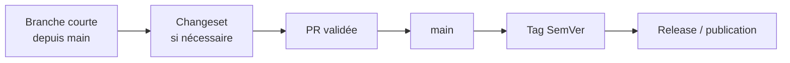

<!-- docs\runbooks\CHANGESETS.md -->

# CHANGESETS — Versionnage et release

## Table des matières

- [CHANGESETS — Versionnage et release](#changesets-versionnage-et-release)
  - [1 · Objectif](#1-objectif)
  - [2 · Flux global](#2-flux-global)
  - [3 · Quand créer un changeset](#3-quand-creer-un-changeset)
  - [4 · Créer un changeset](#4-creer-un-changeset)
  - [5 · PR de travail](#5-pr-de-travail)
  - [6 · Validation avant fusion](#6-validation-avant-fusion)
  - [7 · Release](#7-release)
  - [8 · Version PR](#8-version-pr)
  - [9 · Troubleshooting](#9-troubleshooting)
    - [Aucun changeset n'a été ajouté](#aucun-changeset-na-ete-ajoute)
    - [La PR de version est incorrecte](#la-pr-de-version-est-incorrecte)
    - [Le tag SemVer n'a pas déclenché la release](#le-tag-semver-na-pas-declenche-la-release)
    - [Un changeset a été mergé sans release](#un-changeset-a-ete-merge-sans-release)
  - [10 · Anti-patterns](#10-anti-patterns)
  - [11 · Checklist PR](#11-checklist-pr)

## 1 · Objectif

Changesets sert à documenter les changements versionnés avant une release.

Dans ce dépôt, le workflow actif est aligné sur ARC-22 :

- les branches courtes partent de `main` ;
- les PR de travail ciblent `main` ;
- `main` est la seule branche permanente ;
- les tags SemVer sont posés sur `main` ;
- aucun environnement de préproduction permanent n'est requis.

## 2 · Flux global



## 3 · Quand créer un changeset

Créer un changeset quand le changement doit apparaître dans une release ou modifie une surface consommée :

- package partagé ;
- API publique ;
- contrat partagé ;
- comportement produit important ;
- changement de compatibilité ;
- changement visible pour les utilisateurs ou intégrateurs.

Ne pas créer de changeset pour :

- correction typographique mineure ;
- documentation historique ;
- commentaire interne sans effet ;
- refactor sans impact utilisateur ;
- modification de test sans changement fonctionnel.

## 4 · Créer un changeset

Depuis une branche courte créée depuis `main` :

```bash
git switch main
git pull --ff-only origin main
git switch -c feat/description-courte
pnpm changeset
```

Répondre aux questions de Changesets, puis committer le fichier généré dans `.changeset/`.

Exemple :

```bash
git add .changeset/*.md
git commit -m "docs(changeset): document feature release impact"
```

## 5 · PR de travail

La PR de travail cible `main`.

```bash
git push -u origin HEAD
gh pr create --base main --head "$(git branch --show-current)"
```

Avant de demander review ou merge :

```bash
pnpm format:check
pnpm test:workspace
```

Selon le changement :

```bash
pnpm test:libs
pnpm test:api
pnpm test:unit
pnpm build
```

## 6 · Validation avant fusion

Avant fusion dans `main` :

1. vérifier les checks GitHub ;
2. exécuter les tests et parcours locaux ou éphémères ;
3. vérifier les logs ;
4. tester les parcours concernés ;
5. confirmer que le changeset correspond bien au changement livré.

Si une anomalie est détectée, corriger la PR et réexécuter les contrôles.

## 7 · Release

Après fusion de la PR validée et approbation de la release :

```bash
git switch main
git pull --ff-only origin main
git tag vX.Y.Z
git push origin vX.Y.Z
```

Le tag SemVer déclenche le workflow de production prévu par le runbook [`RELEASE_PROD`](../operations/RELEASE_PROD.md)

## 8 · Version PR

Si un workflow Changesets crée une PR de version, cette PR doit respecter le modèle actif :

- base : `main` ;
- contrôles identiques aux autres PR ;
- aucun mécanisme ne doit recréer une branche ou infrastructure staging.

Le workflow Changesets crée uniquement cette PR de version. La fusion ne publie
pas en production : la promotion reste déclenchée par un tag SemVer créé
manuellement sur `main`, selon le runbook
[`RELEASE_PROD`](../operations/RELEASE_PROD.md).

Le mainteneur doit vérifier :

- les versions modifiées ;
- le changelog généré ;
- les packages impactés ;
- la cohérence avec le périmètre livré.

## 9 · Troubleshooting

### Aucun changeset n'a été ajouté

Si le changement est versionnable :

```bash
pnpm changeset
git add .changeset/*.md
git commit -m "docs(changeset): add release note"
git push
```

Si le changement ne nécessite pas de changeset, documenter la raison dans la PR.

### La PR de version est incorrecte

Corriger sur une branche courte depuis `main`, puis ouvrir une PR vers `main`.

```bash
git switch main
git pull --ff-only origin main
git switch -c fix/version-notes
```

### Le tag SemVer n'a pas déclenché la release

Vérifier :

- que le tag a été créé sur `main`;
- que le tag respecte le format `vX.Y.Z`;
- que le workflow de release est actif ;
- que les permissions GitHub Actions permettent l'exécution attendue.

### Un changeset a été mergé sans release

C'est acceptable tant que la release n'est pas prête. Le changeset reste dans l'historique de `main` et sera pris en compte lors de la prochaine release.

## 10 · Anti-patterns

Ne pas :

- créer un changeset directement sur `main` pour une fonctionnalité non validée ;
- fusionner une PR sans ses contrôles requis ;
- poser un tag SemVer hors de `main` ;
- recréer une branche permanente staging ;
- supprimer un changeset sans justification ;
- mélanger plusieurs changements indépendants dans un seul changeset vague.

## 11 · Checklist PR

- [ ] Branche courte créée depuis `main`
- [ ] Changeset créé si nécessaire
- [ ] PR ciblant `main`
- [ ] Format et tests exécutés
- [ ] Changelog cohérent si généré
- [ ] Pas de tag créé avant merge de release sur `main`
