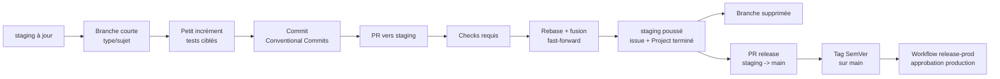

<!-- CONTRIBUTING.md -->

# Guide de contribution

## Table des matières

- [Guide de contribution](#guide-de-contribution)
  - [Branches](#branches)
    - [Nommage](#nommage)
  - [Nommage Angular (Pages Et Composants)](#nommage-angular-pages-et-composants)
  - [Règles Transverses de Qualité et de Maintenabilité (Obligatoires)](#regles-transverses-de-qualite-et-de-maintenabilite-obligatoires)
  - [Commits (Conventional Commits)](#commits-conventional-commits)
    - [Types de commit](#types-de-commit)
    - [Scope (obligatoire)](#scope-obligatoire)
    - [Prompt interactif avec Commitizen](#prompt-interactif-avec-commitizen)
  - [Règle Documentation](#regle-documentation)
  - [Règle Debug](#regle-debug)
  - [Workflow Git complet](#workflow-git-complet)
    - [Interdiction de contournement des hooks](#interdiction-de-contournement-des-hooks)
    - [Stratégie de fusion : rebase uniquement](#strategie-de-fusion-rebase-uniquement)
    - [Séquence type](#sequence-type)
  - [Hooks Git (Husky)](#hooks-git-husky)
    - [Si un hook échoue](#si-un-hook-echoue)
  - [Pull Requests](#pull-requests)
  - [Formatage du code](#formatage-du-code)
    - [Qualité documentaire](#qualite-documentaire)
  - [Politique de langue](#politique-de-langue)
  - [Release](#release)

Ce document explique comment contribuer au dépôt KRAAK Group.

---

## Branches

`main` et `staging` sont les seules branches permanentes. Toute modification passe par une branche courte.

### Nommage

```text
<type>/<sujet-court>
```

Types autorisés :

| Préfixe     | Usage                                           |
| ----------- | ----------------------------------------------- |
| `feat/`     | Nouvelle fonctionnalité                         |
| `fix/`      | Correction de bug                               |
| `docs/`     | Documentation seule                             |
| `chore/`    | Maintenance, dépendances                        |
| `test/`     | Ajout ou modification de tests                  |
| `refactor/` | Refactorisation sans changement de comportement |
| `style/`    | Formatage, espaces, points-virgules             |
| `perf/`     | Amélioration de performance                     |
| `ci/`       | CI/CD (GitHub Actions, Render)                  |
| `build/`    | Build system, scripts                           |
| `revert/`   | Annulation d'un changement                      |

**Exemples :**

```bash
git switch staging
git pull --rebase origin staging
git switch -c feat/contact-form
git switch -c fix/api-cors-error
git switch -c docs/update-readme
```

> Le hook `pre-push` vérifie automatiquement le nommage de la branche. Un nom invalide bloque le push.

---

## Nommage Angular (Pages Et Composants)

Pour les applications client Angular (`web` et `mobile`) :

- une page complète doit être nommée en `*.page.{ts,html,spec.ts}`
- un composant destiné à être intégré dans une page doit être nommé en
  `*.component.{ts,html,spec.ts}`

Cette convention est obligatoire pour tout nouveau fichier et pour toute mise en
conformité des fichiers existants.

---

## Règles Transverses de Qualité et de Maintenabilité (Obligatoires)

1. **Chemins d'import explicites** :

- Utiliser uniquement des chemins d'import explicites (relatifs ou alias documenté) dans tout le code Angular/TypeScript.
- Ne jamais s'appuyer sur des index.ts implicites sauf si l'alias est stable et documenté.
- Objectif : éviter les dépendances circulaires et faciliter la navigation.

1. **Aucun catch silencieux** :

- Tout bloc try/catch doit logguer l'erreur capturée (avec contexte) via Console.
- Ne jamais laisser un catch vide ou avec un simple commentaire.

1. **Nommage de tests Given/When/Then** :

- Tous les tests (unitaires, intégration, E2E) doivent utiliser une formulation Given/When/Then dans la description.
- Les fichiers de test doivent respecter le nom du fichier testé (ex : foo.service.ts → foo.service.spec.ts).

1. **Pas de code mort** :

- Tout code commenté doit être supprimé avant merge.
- Si un code est laissé pour plus tard, ajouter un TODO avec référence issue/JIRA.

1. **Lint/format strict sur CI** :

- Linting (ESLint, Prettier, markdownlint) et type-checking obligatoires en CI avant merge.

1. **Aucun style direct dans les templates** :

- Ne jamais utiliser d'attribut `style` ou de balise `style` dans les templates Angular.
- Tout style doit passer par Tailwind ou les styles globaux.

1. **Versionning API/DTO** :

- Tout changement de contrat API/DTO doit être versionné ou documenté dans un changelog, et les consommateurs mis à jour.

1. **Aucun secret/URL en dur** :

- Toute clé, secret ou URL d'environnement doit passer par une variable d'environnement ou un fichier de config, jamais en dur dans le code.

1. **Accessibilité par défaut** :

- Tout nouveau composant/page UI doit inclure au moins une validation d'accessibilité (aria-label, navigation clavier, contraste).

Les indicateurs de focus globaux restent hors des couches Tailwind pour ne pas
être annulés par `outline-none`. Les animations décoratives et les délais de
révélation ne sont activés qu'avec `prefers-reduced-motion: no-preference`.
`RevealOnScrollDirective` transmet le délai par `--reveal-delay`, sans surcharger
directement `transition-delay`. Les régressions Playwright vérifient le focus,
les délais calculés et le changement de préférence de mouvement sur les trois
moteurs.

1. **Documentation à jour** :

- Tout changement d'architecture ou de process doit être répercuté dans la doc Markdown dans le même commit que le code.

---

## Commits (Conventional Commits)

Chaque message de commit suit le format [Conventional Commits](https://www.conventionalcommits.org/) :

```text
<type>(<scope>): <description courte>
```

**Exemples :**

```text
feat(web): ajouter la page d'accueil
fix(api): corriger le CORS pour /contact
docs(docs): mettre à jour le README
chore(repo): mettre à jour les dépendances pnpm
test(api): ajouter un test pour le service contact
```

> Le hook `commit-msg` valide automatiquement le format via **commitlint**. Un commit mal formaté sera rejeté.

### Types de commit

Ce sont les mêmes que les préfixes de branche : `feat`, `fix`, `docs`, `chore`, `test`, `refactor`, `style`, `perf`, `ci`, `build`, `revert`.

### Scope (obligatoire)

Indique la partie du projet concernée. Scopes autorisés :
`root`, `repo`, `workspace`, `config`, `docs`, `scripts`, `web`, `mobile`,
`api`, `client`, `contracts`, `domain`, `api-client`, `tokens`, `infra`, `ci`,
`supabase`. La liste canonique est définie dans `commit-scopes.cjs` et partagée
par Commitizen et commitlint.

Le lint Markdown s'applique aux documents actifs. Les archives, les instructions
d'outillage et la référence PrimeNG générée sont exclus. La validité des ancres
des tables des matières est contrôlée par `pnpm docs:toc:check` plutôt que par la
règle markdownlint `MD051`.

### Prompt interactif avec Commitizen

Pour créer un commit avec un assistant interactif, utiliser :

```bash
pnpm commit
```

Le prompt propose les types et scopes autorisés, puis génère un message compatible
avec `commitlint`.

---

## Règle Documentation

Toute modification du codebase qui rend un document inexact, incomplet ou
ambigu impose une mise à jour de la documentation dans le même changement.

Cela couvre notamment :

- les chemins et la structure du dépôt
- les scripts et commandes de travail
- les variables d'environnement
- les comportements visibles et contrats techniques
- les conventions Git, de test ou de déploiement

Ne pas remettre une mise à jour documentaire nécessaire à plus tard.

---

## Règle Debug

En phase de débogage ou d’investigation, utiliser régulièrement les méthodes de
l’objet `Console` (`console.debug`, `console.info`, `console.warn`,
`console.error`) pour tracer les étapes clés et accélérer le diagnostic.

Quand un flux applicatif intercepte une erreur, un rejet, ou un état inattendu
sans le relancer, laisser une trace via les méthodes de l’objet `Console`
(`console.error`, `console.warn`, `console.info`, `console.debug`) avec un
contexte bref et utile au diagnostic.

Contraintes obligatoires :

- ne jamais logger de mot de passe, token, secret, cookie, ou payload complet
  sensible
- préférer un scope court et stable (ex : `web.auth.sign-in.submit`)
- garder les traces orientées diagnostic, pas verbeuses

Les résumés et erreurs du script d'observabilité remplacent explicitement les
retours à la ligne externes par des espaces, puis sérialisent les autres
caractères de contrôle en JSON avant journalisation. Les URL et réponses de santé
ne peuvent pas produire de fausses lignes de journal.

---

## Workflow Git complet

### Interdiction de contournement des hooks

Le flag `--no-verify` est strictement interdit pour toutes les commandes Git
(`commit`, `push`, etc.).

Si un hook échoue, il faut corriger la cause (format, lint, typecheck, tests,
nommage) puis relancer la commande, sans contourner les contrôles.

Avant de commencer à coder, chaque collaborateur doit **s'assigner une tâche**
sur le **GitHub Project lié à ce dépôt**. Ne pas démarrer un travail sans item
de Project clairement pris en charge.

### Stratégie de fusion : rebase uniquement

Ne jamais créer de merge commits. Toujours rebaser la branche courte sur `staging`
avant de fusionner en fast-forward.

La configuration locale du dépôt impose :

```bash
git config pull.rebase true
git config merge.ff only
```

Ces réglages sont déjà appliqués dans le `.git/config` du dépôt. Si vous clonez
à nouveau, ré-exécutez les deux commandes ci-dessus.

### Séquence type



`main` n'est pas une branche de développement. Elle avance uniquement par PR de
release depuis `staging`, puis par tag SemVer validé.

---

## Hooks Git (Husky)

Des vérifications automatiques s'exécutent à chaque étape :

| Moment       | Vérification                                               | Effet si échec |
| ------------ | ---------------------------------------------------------- | -------------- |
| `commit-msg` | Format Conventional Commits (commitlint)                   | Commit rejeté  |
| `pre-commit` | `lint-staged`, puis `pnpm check` sur tout le dépôt         | Commit rejeté  |
| `pre-push`   | Nom de branche valide, puis `pnpm check` sur tout le dépôt | Push rejeté    |

`pnpm check` vérifie le formatage, le lint du code et du Markdown, construit les
packages nécessaires, vérifie les types, puis mesure la couverture des scripts,
de l'API, du web, du mobile et des packages partagés. Chaque fichier exécutable
doit atteindre **100 %** en instructions, branches, fonctions et lignes.
L'absence de pnpm est une erreur bloquante, jamais un contrôle réussi.

Le contrôle standard ne demande aucun secret réseau. `pnpm check:full` ajoute les
builds applicatifs, les E2E web/mobile et SonarCloud. Cette variante exige les
navigateurs Playwright et `SONAR_TOKEN`. Les E2E restent également exécutés par
leurs jobs CI dédiés.

Les vérifications web/API d'observabilité, le formatage des index documentaires,
les exports de formats distincts, les variantes d'icônes et le nettoyage de
répertoires indépendants s'exécutent en parallèle. Les résultats et journaux
d'export conservent leur ordre déclaré ; les erreurs restent bloquantes.
Les dépendances restent séquentielles : le launcher rond attend son image source,
et le démarrage local conserve l'ordre des services et la recherche progressive
des ports disponibles.

### Si un hook échoue

- **Formatage / lint pre-commit** : corriger les erreurs remontées par `lint-staged` puis recommiter
- **Lint** : corriger les erreurs signalées par ESLint
- **Typecheck** : corriger les erreurs TypeScript signalées par le contrôle ciblé (API, web, mobile, ou global)
- **Nom de branche** : renommer avec `git branch -m <nouveau-nom>`
- **Message de commit** : relancer `pnpm commit` et choisir un scope autorisé
- **Tests** : corriger les tests cassés avant de pousser (les tests E2E exhaustifs restent pilotés par la CI)

---

## Pull Requests

- Ouvrir la PR vers `staging`
- Remplir le template de PR (description, tests, captures d'écran si UI)
- Attendre la review avant de fusionner
- Fusionner exclusivement en **rebase and merge** (pas de merge commit, pas de squash)
- Après fusion, supprimer la branche locale et distante :

```bash
git switch staging
git pull --rebase origin staging
git branch -d feat/ma-feature
git push origin --delete feat/ma-feature
```

---

## Formatage du code

Le projet utilise **Prettier** pour le formatage automatique.

```bash
# Formater tous les fichiers
pnpm format

# Vérifier le formatage (sans modifier)
pnpm format:check
```

Le hook `pre-commit` s'appuie sur `lint-staged.config.cjs` pour n'exécuter le
formatage et le lint correctifs que sur les fichiers indexés. Il applique
Prettier avant markdownlint sur les fichiers Markdown, puis lance le contrôle
global en lecture seule. Le hook `pre-push` réexécute ce même contrôle, même
pour un changement documentaire ou lorsque le diff ne peut pas être déterminé.
Le formatage global couvre aussi les scripts JavaScript et les workflows YAML.

Les hooks définissent `GIT_EXECUTABLE` avec un chemin absolu vers `git` (ou utilisent une valeur déjà fournie par l'environnement) pour verrouiller le binaire appelé. En CI, `GIT_EXECUTABLE` est fixé globalement à `/usr/bin/git`.

Le runner et le scanner Sonar partagent `quoteWindowsArgument` dans
`scripts/workspace-commands.mjs` pour conserver le même échappement des espaces,
guillemets et antislashs lors des lancements sous Windows.

Pour accélérer les vérifications locales sur une branche de travail, utiliser d'abord les scripts ciblés suivants quand la portée est limitée :

- `pnpm affected:lint`
- `pnpm affected:test`
- `pnpm affected:build`

En CI, conserver le cache pnpm déjà configuré via `actions/setup-node` et, si un nouveau workflow est ajouté, garder `cache: pnpm` avec `cache-dependency-path: pnpm-lock.yaml` pour stabiliser les temps d'installation.

### Qualité documentaire

Les index documentaires générés se contrôlent avec :

```bash
pnpm docs:index:check
pnpm docs:index:write
pnpm docs:toc:check
pnpm docs:toc:write
```

La génération des sommaires utilise le résolveur Git partagé, sans recherche
implicite dans `PATH`. Les titres malformés sont analysés sans expressions
régulières à retour arrière non borné ; les régressions couvrent les longs
titres, les liens incomplets et la préservation des ancres et fins de ligne.

Le workflow `.github/workflows/docs-quality.yml` exécute sur pull request :

- Prettier uniquement sur les fichiers Markdown modifiés ;
- l'audit local `pnpm docs:audit:strict` pour les liens internes, ancres,
  métadonnées actives, références de fournisseur retiré, doublons ADR,
  marqueurs de merge et blocs Mermaid invalides ;
- `pnpm docs:index:check` pour empêcher un index ADR ou documentaire obsolète.
- `pnpm docs:toc:check` pour empêcher une table des matières Markdown absente
  ou obsolète.

Le hook `pre-commit` ne lance ni vérification réseau, ni audit complet de tout
l'arbre documentaire, mais il impose le contrôle qualité global décrit plus
haut. L'audit hebdomadaire planifié exécute
`bash scripts/audit-docs.sh --full --network --output .reports/docs-audit` et
publie `.reports/docs-audit/` comme artefact GitHub Actions.

---

## Politique de langue

- **Code** (variables, fonctions, types, noms de fichiers) : **anglais**
- **Documentation, commentaires, textes UI, messages** : **français**

## Release

Une release suit un flux séparé :

1. Valider `staging`.
2. Ouvrir une PR `staging → main`.
3. Merger la PR de release après validation.
4. Créer un tag SemVer sur `main`.
5. Laisser le workflow de production gérer l'approbation et le déploiement.

Aucun tag de production ne doit être posé sur `staging`.
