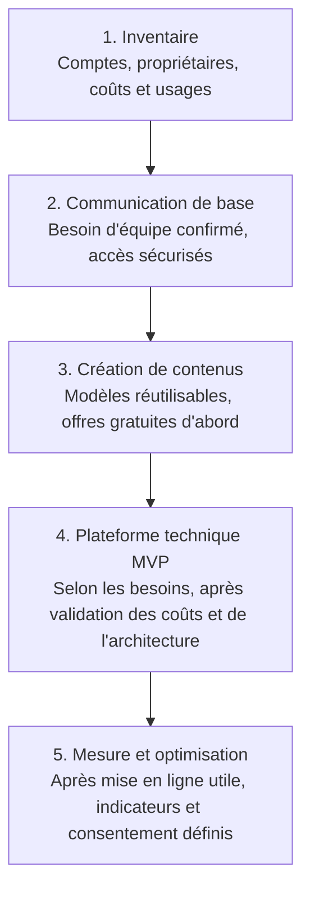

# Plan des outils numériques KRAAK

## Table des matières

- [Plan des outils numériques KRAAK](#plan-des-outils-numeriques-kraak)
  - [Objectif et règles de lecture](#objectif-et-regles-de-lecture)
  - [Panorama et budgets indicatifs](#panorama-et-budgets-indicatifs)
  - [Ordre de mise en place](#ordre-de-mise-en-place)
  - [Gouvernance](#gouvernance)
  - [Révision du plan](#revision-du-plan)

Ce plan rassemble les outils utiles à la communication, à la création de
contenus et à la plateforme numérique de KRAAK. Il décrit une cible de
planification ; il n'autorise ni achat, ni ouverture de compte, ni activation
d'un service.

## Objectif et règles de lecture

- Les décisions d'architecture existantes restent prioritaires. Pour la stack
  technique, voir [`ARCHITECTURE.md`](../../ARCHITECTURE.md) et les ADR actives.
- Les tarifs ci-dessous sont des hypothèses de cadrage en dollars américains,
  hors taxes, change, frais de télécommunication et remise éventuelle. Ce ne
  sont ni des devis ni des tarifs vérifiés auprès des fournisseurs.
- Le coût réel dépend des utilisateurs, du trafic, du stockage et des fonctions
  activées. Vérifier les prix officiels et le coût total avant tout engagement.
- Un outil indiqué « à valider » reste une option : ne pas créer de compte ni
  transférer de données avant approbation.

## Panorama et budgets indicatifs

| Domaine                 | Outil / option                                           | Rôle                                                                            | État dans le plan                                                                            | Budget indicatif                                                                       |
| ----------------------- | -------------------------------------------------------- | ------------------------------------------------------------------------------- | -------------------------------------------------------------------------------------------- | -------------------------------------------------------------------------------------- |
| Communication           | Suite de messagerie et calendrier (ex. Google Workspace) | Adresse professionnelle, calendrier partagé, réunions et partage de documents   | À arbitrer selon les comptes déjà disponibles                                                | 0–15 $ / utilisateur / mois                                                            |
| Communication           | WhatsApp Business                                        | Canal de contact rapide si confirmé comme pertinent pour les publics            | Option à valider ; numéro et disponibilité à confirmer                                       | 0 $ pour l'application ; forfait téléphonique et données exclus                        |
| Création                | Canva                                                    | Création de visuels réutilisables pour le site et les communications            | Commencer par une offre gratuite ; offre payante seulement si besoin établi                  | 0–15 $ / éditeur / mois                                                                |
| Collaboration et code   | GitHub                                                   | Dépôt, suivi des tâches, revues et automatisations du code                      | Déjà utilisé pour le dépôt et le Project #8                                                  | 0–5 $ / utilisateur / mois à vérifier selon le forfait retenu                          |
| Hébergement             | Render                                                   | Hébergement de production du site web et de l'API                               | Stack active ; ne pas créer de service supplémentaire                                        | Enveloppe de travail : 0–50 $ / mois, à confirmer sur la facture et le dimensionnement |
| Données et stockage     | Supabase                                                 | PostgreSQL, authentification ou stockage lorsque ces fonctions sont nécessaires | Cible technique existante ; usage et plan à confirmer avant activation                       | Enveloppe de travail : 0–25 $ / mois au démarrage, selon les besoins                   |
| E-mails transactionnels | Resend                                                   | Envoi des e-mails déclenchés par les fonctionnalités de l'API                   | Cible technique existante ; consommation à surveiller                                        | Enveloppe de travail : 0–20 $ / mois au démarrage, selon le volume                     |
| Présence web            | Nom de domaine                                           | Adresse publique de KRAAK                                                       | Conserver le domaine et le fournisseur déjà gérés ; aucun nouvel achat décidé ici            | 10–30 $ / an à titre de provision, renouvellement à vérifier                           |
| Mesure d'audience       | Analytics respectueux du périmètre MVP                   | Mesure agrégée des visites et conversions utiles                                | À décider selon le besoin, le consentement et la conformité ; aucun outil activé par ce plan | 0–20 $ / mois en hypothèse ; confirmer le coût et les obligations avant choix          |

Les montants des services techniques ne constituent pas une estimation de la
facture actuelle de KRAAK. Les coûts variables, les taxes, le change et les
options payantes sont à ajouter après vérification. Les dépenses par utilisateur
ou éditeur doivent être multipliées par le nombre de licences réellement
nécessaires ; ne pas additionner les options qui ne sont pas retenues.

## Ordre de mise en place

| Étape                       | Priorité                     | Résultat attendu                                                                                               | Condition de passage                                                                        |
| --------------------------- | ---------------------------- | -------------------------------------------------------------------------------------------------------------- | ------------------------------------------------------------------------------------------- |
| 1. Inventaire               | Première                     | Identifier les comptes, propriétaires, coûts réels, renouvellements et usages existants                        | Aucun nouvel outil tant que les accès et abonnements en place ne sont pas recensés          |
| 2. Communication de base    | Ensuite                      | Stabiliser l'adresse de contact, le calendrier et le partage documentaire ; confirmer ou non le canal WhatsApp | Besoin d'équipe confirmé, accès sécurisés, coût et responsabilité définis                   |
| 3. Création de contenus     | Ensuite                      | Préparer quelques modèles réutilisables conformes à l'identité visuelle                                        | Tester d'abord les outils gratuits ; justifier toute licence payante par un usage récurrent |
| 4. Plateforme technique MVP | Selon les besoins du produit | Faire évoluer le site, l'API, les données et les e-mails dans les services déjà retenus                        | Décision d'architecture et validation des coûts, de la sécurité et des données              |
| 5. Mesure et optimisation   | Après mise en ligne utile    | Suivre les indicateurs nécessaires aux parcours du site                                                        | Définir les indicateurs, le consentement et la durée de conservation avant activation       |

Cet ordre est une séquence de cadrage et de décision, pas une commande
d'implémentation. Une étape peut être différée si le besoin n'est pas démontré.

Vue d'ensemble du parcours ; les conditions du tableau restent déterminantes :

## Gouvernance

- **Responsable métier** : confirme le besoin, l'audience, les contenus et le
  bénéfice attendu ; valide les dépenses récurrentes.
- **Responsable technique** : vérifie la compatibilité avec l'architecture,
  les accès, la sécurité, les intégrations, les sauvegardes et la possibilité de
  quitter le service.
- **Responsable de compte** : est désigné pour chaque service retenu et suit les
  licences, renouvellements, factures et révocations d'accès.
- **Avant tout achat ou activation** : documenter le besoin, le propriétaire,
  les données traitées, le coût estimé et récurrent, les conditions de
  renouvellement et l'alternative en cas d'arrêt. Obtenir l'approbation du
  responsable métier et du responsable technique pour un service qui traite des
  données ou touche à la plateforme.
- **Accès** : utiliser des comptes professionnels nominatifs, le moindre
  privilège et l'authentification multifacteur lorsqu'elle est proposée.
  Révoquer rapidement les accès qui ne sont plus nécessaires.
- **Données et secrets** : limiter les données personnelles au besoin, vérifier
  les conditions de traitement et de conservation, et ne jamais placer de
  secrets ou de données personnelles dans le dépôt, les tickets publics ou les
  outils de création.
- **Architecture** : une option de cette fiche ne remplace pas une ADR ou une
  architecture active. Tout nouveau service technique ou changement de
  fournisseur doit suivre les décisions d'architecture du dépôt et être
  documenté avant son adoption.
- **Suivi** : tenir l'inventaire des services effectivement souscrits à jour
  avec leur propriétaire, leur usage, leur budget, leur prochaine échéance et
  leur statut (à valider, actif ou retiré).

## Révision du plan

Revoir ce plan au moins une fois par an, et avant tout nouvel abonnement ou
changement de service. Mettre à jour les budgets à partir des prix officiels et
des factures réelles ; conserver les options non retenues comme telles, sans les
présenter comme des outils déjà actifs.
