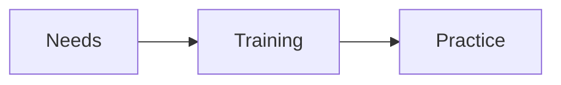

# Training and impact

KRAAK supports teams in developing their skills. Participants define their goals
and review the expected outcomes together.

## Approach

1. Identify needs.
2. Practise skills.
3. Review outcomes.

| Service  | Audience      |
| -------- | ------------- |
| Training | Teams         |
| Advice   | Organisations |

