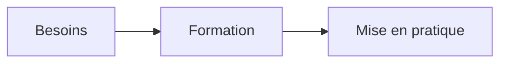

# Formation et impact

KRAAK accompagne les équipes dans le développement de leurs compétences.
L'objectif est de soutenir une action autonome, rigoureuse et accessible.

## Parcours

- Définir les besoins.
  - Écouter les participants.
  - Préciser les résultats attendus.
- Construire un accompagnement adapté.

[Revenir au parcours](#parcours) et [consulter la référence](https://example.org).

## Offres

| Offre             | Public             | Résultat     |
| ----------------- | ------------------ | ------------ |
| Formation         | Équipes            | Compétences  |
| Conseil           | Organisations      | Orientation  |
| Gestion de projet | Responsables       | Coordination |
| Atelier           | Participants       | Pratique     |
| Accompagnement    | Porteurs de projet | Autonomie    |
| Évaluation        | Équipes            | Retour       |
| Suivi             | Responsables       | Continuité   |

## Diagramme



## Exemple technique

```js narration: Le statut de cet exemple est prêt.
const status = 'ready';
```

## Conclusion

Les résultats attendus sont définis avec les participants et relus à chaque étape.
La démarche conserve une place pour les questions, les retours et les ajustements.
